# 🌱 Cultive um Jardim 2 — jogo estilo "Grow a Garden 2" para Roblox

Jogo completo de fazenda para Roblox inspirado no **Grow a Garden 2**, com as mecânicas do **Grow a Garden
original**: compre sementes, plante, veja as plantas crescerem, colha, venda, compre equipamentos, choque
ovos de pets e aproveite os climas que criam mutações valiosas. Quando cai a **noite**, os jardins sem
dono por perto podem ser **roubados**, e as plantas de defesa e os pets entram em ação.

Os modelos 3D foram feitos no **Blender** (por script) e a lógica do jogo roda no **Roblox Studio** (Luau).

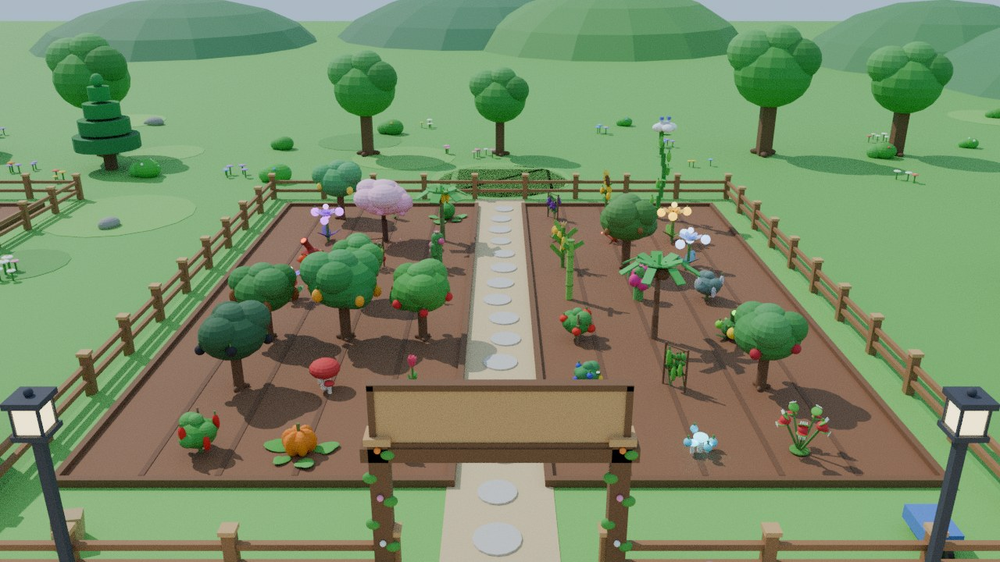

> **Importante**
>
> - **Não dá para "conectar" este jogo ao Grow a Garden 2 de verdade.** Ele é de outra equipe, e o
>   Roblox não deixa um jogo usar o servidor, os itens ou os dados de outro. O que este projeto faz é
>   recriar as **mecânicas** do Grow a Garden 2 (e do original) num jogo **seu**, com nome, código e
>   modelos próprios.
> - O nome "Grow a Garden" e as artes originais pertencem aos criadores do jogo original. Não use o nome
>   nem as artes deles se for publicar.
> - Um jogo de Roblox não pode ser feito *só* no Blender: o Blender faz os **modelos 3D**, e as regras,
>   lojas, salvamento e interface são feitos em **Luau, no Roblox Studio**. Por isso o projeto tem as
>   duas partes: `src/` (scripts do Roblox) e `blender/` (modelos 3D).

---

## ✨ O que tem no jogo

| Sistema | Como funciona |
|---|---|
| 🏡 **6 jardins** | Cada jogador ganha um jardim cercado, com placa com seu nome. |
| 🌱 **45 plantas** | 42 na loja do Sam, de Comum a Super, e 3 secretas de fusão. Tem as do Grow a Garden 2 (Dioneia, Cuspidor de Veneno, Flor da Lua, Flor do Sol, Flor Hipnótica, Girassol, Picolé Foguete...), a **Cerejeira** e as clássicas (Melancia, Abóbora, Narciso, Pimenta, Cacau, Pé de Feijão). |
| 🌿 **Plantas crescendo de verdade** | A semente vira um broto na terra, a planta cresce em 40 etapas e os frutos nascem verdes e mudam de cor até amadurecer. |
| 🔁 **Colheita única ou várias** | Algumas plantas são colhidas inteiras; outras ficam e dão frutos várias vezes. |
| 🎨 **Variantes e tamanhos** | Quase todas as plantas têm uma variante de cor rara (Morango Branco, Tulipa Negra, Milho Azul...) e qualquer uma pode sair de **Cristal** (x2,5). Os frutos vão de Pequeno a Colossal. |
| 🌙 **Dia e noite** | 7 min e 30 s de dia, 30 s de pôr do sol e 2 min de noite, com postes que acendem. |
| 🦝 **Roubo à noite** | Segure **Roubar** num fruto maduro de outro jardim e leve até o **seu** jardim antes de ser pego. O jardim fica trancado quando o dono está nele ou tem um Gnomo ativo. |
| 🛡️ **Defesas** | Cacto (espinhos), Hera Venenosa (veneno e lentidão), Dioneia (mordida forte), Cuspidor de Veneno e Sopro do Dragão (tiros), Flor Hipnótica (expulsa ladrões), pets guardiões, Atirador de Morango, Pá (acerte o ladrão e ele solta o fruto) e Lanternas (revelam ladrões invisíveis). |
| ✨ **25 mutações e combinações** | De Molhado (x2) a Cósmico (x300). Algumas se juntam: Molhado + Gelado = Congelado, Molhado + Arenoso = Barro, Barro + Ressecado = Cerâmica, Eletrizado + Inflamado = Plasma, Eclipsado + Sangrento = Abissal, Celestial + Estelar = Cósmico. |
| 🌦️ **18 climas** | De dia: Chuva, Tempestade, Geada, Nevasca, Tempestade de Areia, Onda de Calor, Tornado, Arco-íris, Explosão Solar e Chuva de Chocolate. De noite: Lua de Sangue, Lua Dourada, Lua Arco-íris, Lua Gigante, Chuva de Meteoros, Aurora e Chuva de Estrelas. E o **Eclipse**, invocado pela Flor do Eclipse. |
| 🔧 **14 equipamentos** | Regador, Espátula (move plantas e faz fusões), Pá, cogumelos de Velocidade, Pulo e Invisibilidade, 5 Sprinklers, Lanterna, Gnomo e Atirador de Morango. |
| 🐾 **22 pets e 6 ovos** | Pets com variantes (Normal, Grande, Arco-íris e Mega), níveis até 50 e habilidades: colher sozinho, guardar o jardim, polinizar, dar sorte, deixar frutos maiores... |
| 📜 **Missões diárias** | 3 missões novas por dia (colher, plantar, vender, roubar, chocar ovos...) com recompensa em Sheckles. |
| 📖 **Índice de mutações** | Mostra todas as mutações, os multiplicadores e como conseguir cada uma. |
| 🧑‍🌾 **Vendedores** | Sam (sementes), Steven (compra frutos), George (equipamentos) e Eloise (ovos e pets): bonecos no estilo Roblox que acenam e falam com você. |
| 🛒 **Estoque global** | As lojas reabastecem a cada 5 minutos, com o mesmo estoque em todos os servidores. |
| ⏱️ **Crescimento offline** | As plantas continuam crescendo com você fora do jogo. |
| 💾 **Salvamento** | DataStore com novas tentativas, salvamento automático e ao fechar o servidor. Dados da versão anterior são convertidos sozinhos. |
| 📱 **Interface caprichada** | Painéis com sombra e gradiente, ícone em cada item, cores por raridade (Super com arco-íris), botões com relevo que crescem ao passar o mouse, dinheiro que sobe animado, barra do dia/noite, missões com barra de progresso e avisos com ícones. Funciona no PC e no celular. |
| 🏞️ **Mapa bonito** | Praça com chafariz, bancos e canteiros de flores, portal de boas-vindas, arcos de entrada com o nome do dono, canteiros com moldura de madeira, lojas com toldo de babado, prateleiras e caixotes, árvores variadas (pinheiros, cerejeiras, macieiras), flores, arbustos, pedras e morros no horizonte. |
| 🌤️ **Iluminação** | Cores mais vivas, brilho suave nas luzes, raios de sol, nuvens de verdade no céu e postes que acendem à noite. |
| 🐶 **Pets com cara própria** | Cada um dos 22 pets tem detalhes próprios: orelhas, focinho ou bico, asas, chifres, casco, rabo (o da Kitsune tem 3 caudas) e patas. |

### 🏆 O que este jogo faz melhor que o original

- Junta o **Grow a Garden 2** (noite, roubo, plantas de defesa, Espátula e fusões) com o **original**
  (climas com mutações, sprinklers, ovos, crescimento offline e plantas de colheita única).
- **Combinações de mutações** e luas especiais à noite que deixam os frutos muito mais valiosos.
- **Variantes de cor e de Cristal**, além das classes de tamanho (de Pequeno a Colossal).
- **Missões diárias**, **índice de mutações**, **níveis e variantes de pets**.
- **3 plantas secretas de fusão**: Flor do Sol + Flor da Lua = **Flor do Eclipse** (invoca o Eclipse),
  Pimenta Fantasma + Samambaia de Fogo = **Pimenta Infernal**, Carambola + Semente Arco-íris =
  **Fruta Galáctica**.
- Plantas com poderes: a Cerejeira solta pétalas e poliniza, o Cogumelo Brilhante faz os frutos de perto
  brilharem à noite e a Samambaia de Fogo pode deixar seus frutos Inflamados.
- Visual mais caprichado: interface com ícones e animações, praça com chafariz, lojas decoradas, iluminação
  com efeitos e pets cheios de detalhes.

<p>
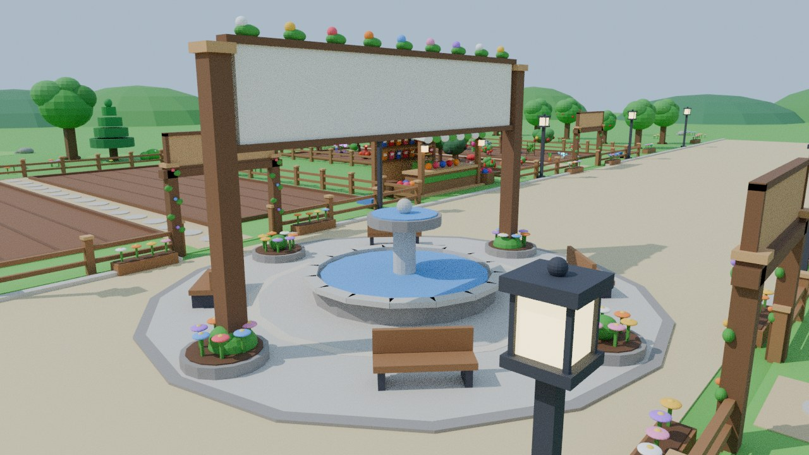 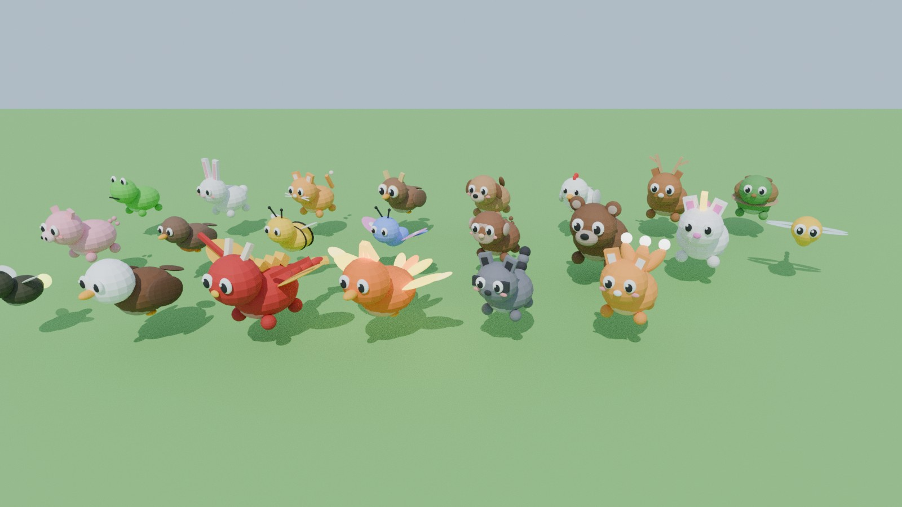
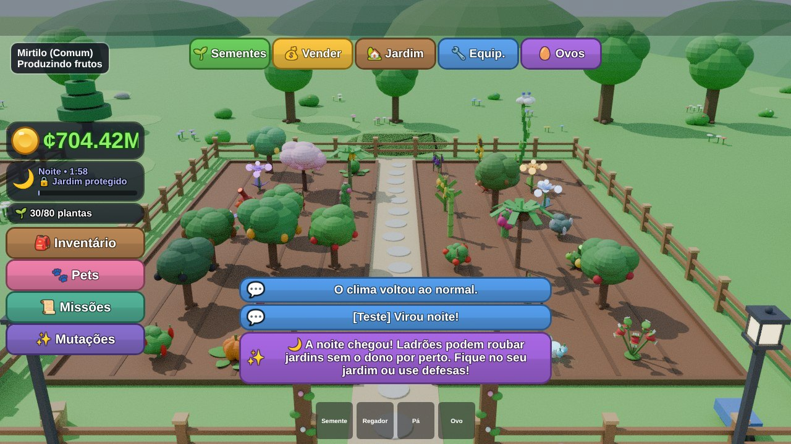 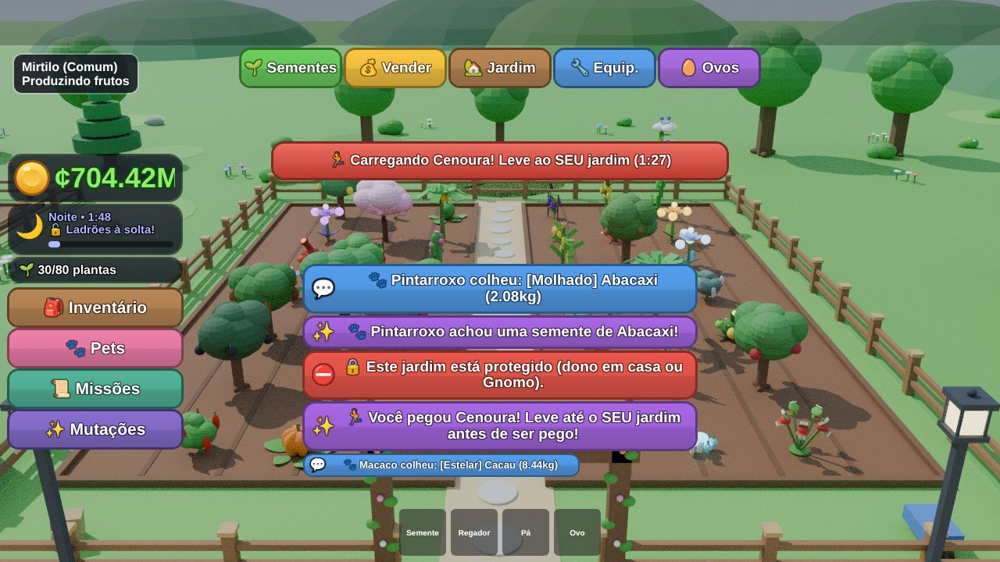
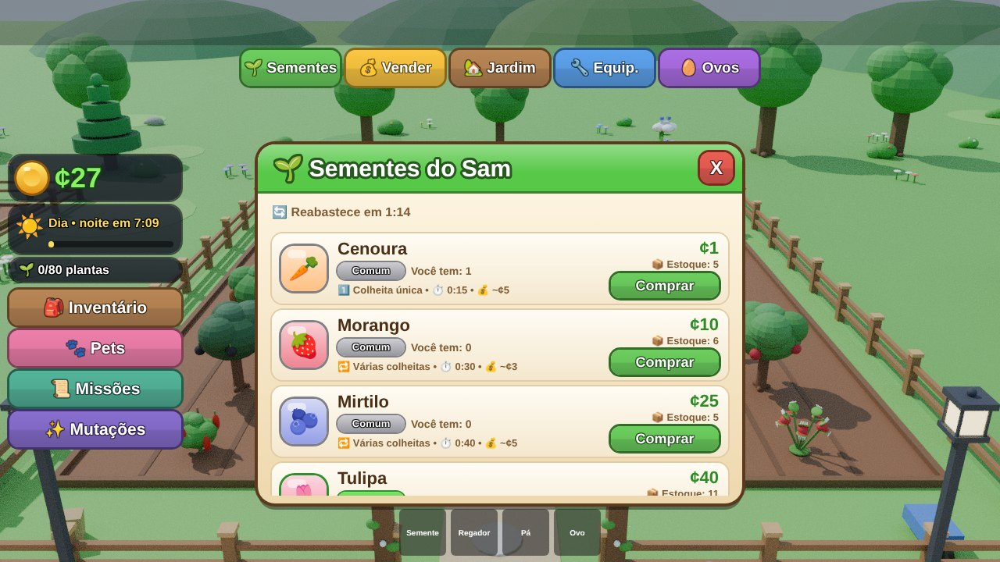 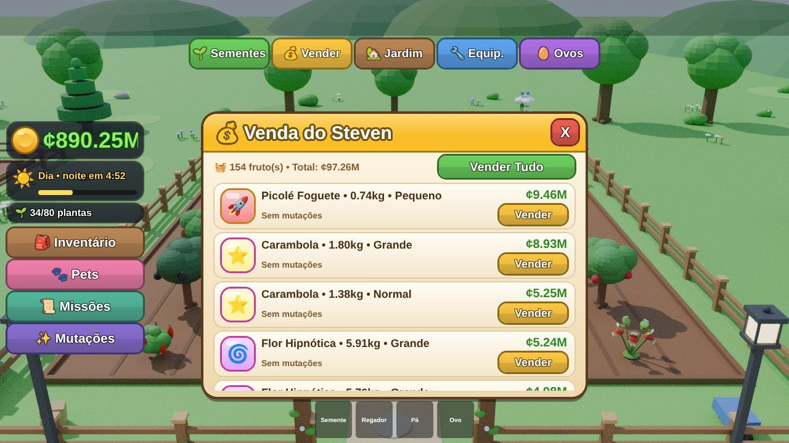
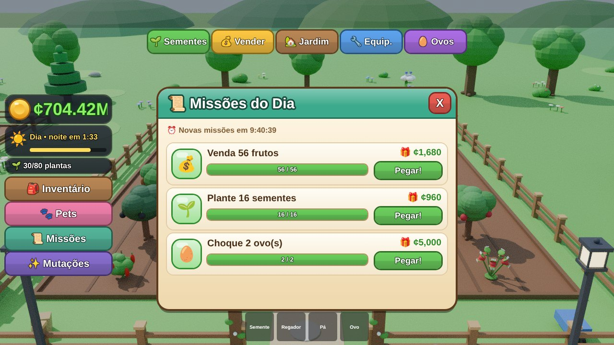 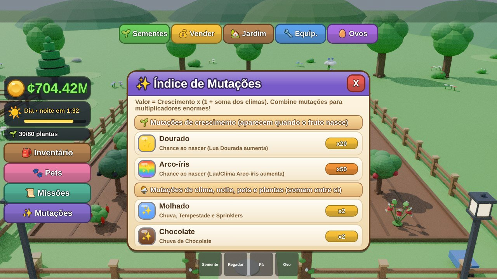
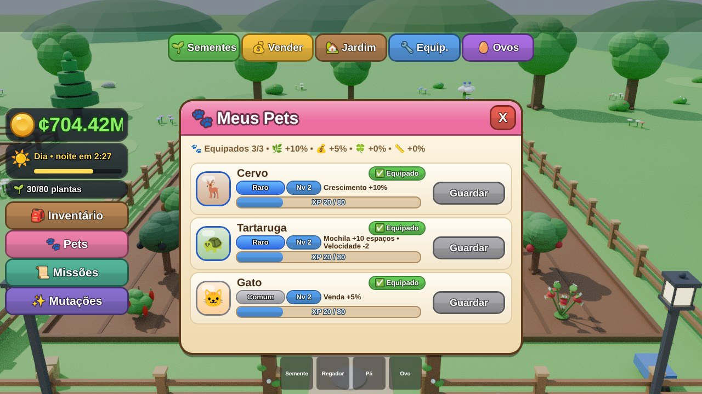 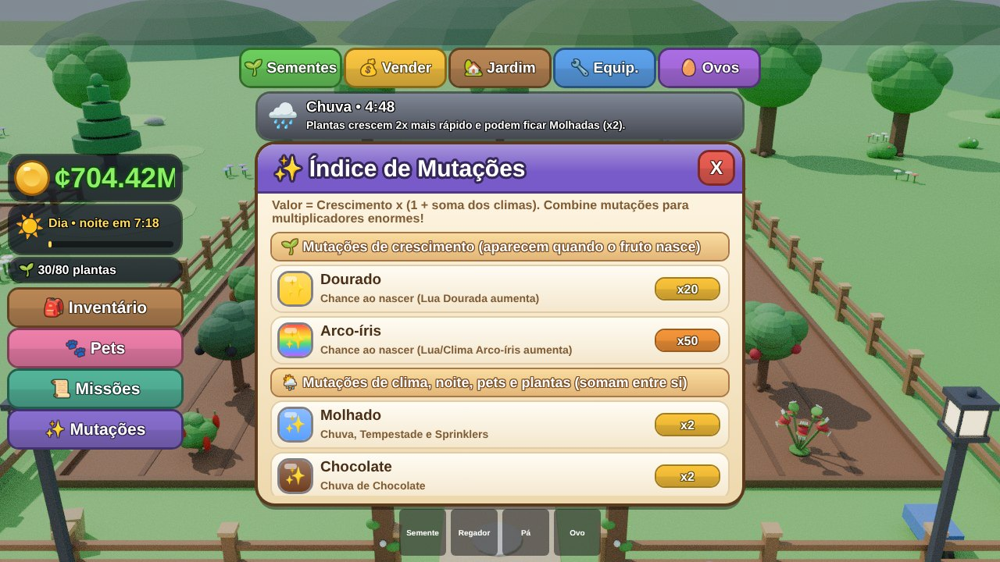
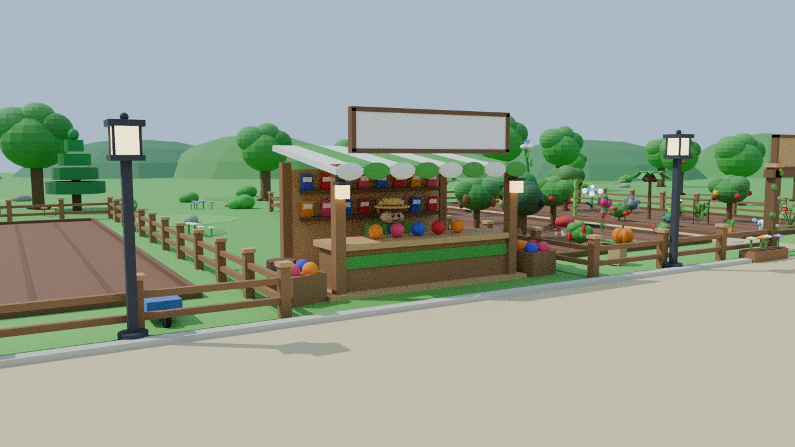 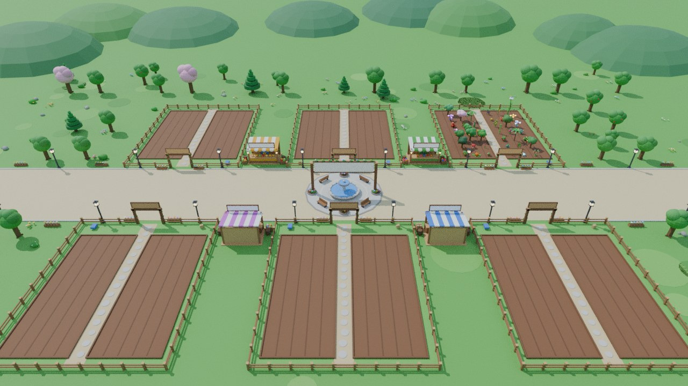
</p>

*Prévias geradas pelo simulador de testes (veja abaixo). No Roblox o visual fica parecido, com os
textos das placas e a iluminação do Roblox.*

---

## 🚀 Como abrir no Roblox Studio

### Opção 1 — Abrir o arquivo pronto (mais fácil)

1. Baixe o arquivo **`CultiveUmJardim.rbxlx`** desta pasta.
2. Abra o **Roblox Studio** → **Arquivo › Abrir do Arquivo** (*File › Open from File*) → escolha o `.rbxlx`.
3. Aperte **Play (F5)**. O mapa inteiro é criado sozinho quando o jogo começa.

> No modo de edição o mundo aparece vazio: é normal, porque o mapa é gerado por código ao dar Play.

### Opção 2 — Copiar os scripts à mão

Crie no Explorer exatamente esta estrutura e cole o conteúdo de cada arquivo:

```
ReplicatedStorage
├── Shared              (Folder)
│   ├── Config          (ModuleScript)  ← src/ReplicatedStorage/Shared/Config.luau
│   └── Formulas        (ModuleScript)  ← src/ReplicatedStorage/Shared/Formulas.luau
└── Modelos             (Folder)        ← aqui vão os modelos do Blender (opcional)

ServerScriptService
└── GardenServer        (Script)        ← src/ServerScriptService/GardenServer/init.server.luau
    ├── DataService     (ModuleScript)  ← DataService.luau
    ├── DayNightService (ModuleScript)  ← DayNightService.luau
    ├── GardenService   (ModuleScript)  ← GardenService.luau
    ├── Inventory       (ModuleScript)  ← Inventory.luau
    ├── MapBuilder      (ModuleScript)  ← MapBuilder.luau
    ├── PetService      (ModuleScript)  ← PetService.luau
    ├── QuestService    (ModuleScript)  ← QuestService.luau
    ├── Remotes         (ModuleScript)  ← Remotes.luau
    ├── ShopService     (ModuleScript)  ← ShopService.luau
    ├── StealService    (ModuleScript)  ← StealService.luau
    ├── Sync            (ModuleScript)  ← Sync.luau
    ├── Visuals         (ModuleScript)  ← Visuals.luau
    └── WeatherService  (ModuleScript)  ← WeatherService.luau

StarterPlayer
└── StarterPlayerScripts
    └── GardenClient    (LocalScript)   ← src/StarterPlayerScripts/GardenClient/init.client.luau
        ├── Effects     (ModuleScript)  ← Effects.luau
        └── Interface   (ModuleScript)  ← Interface.luau
```

Os ModuleScripts ficam **dentro** do Script/LocalScript (como filhos), e os nomes precisam ser iguais.

### Opção 3 — Rojo (para quem programa)

```bash
rojo serve        # sincroniza com o Studio usando default.project.json
rojo build -o CultiveUmJardim.rbxlx
```

### Configurações recomendadas

1. **Salvar o progresso:** publique o jogo (*File › Publish to Roblox*) e ative
   **Game Settings › Security › Enable Studio Access to API Services**.
   Sem isso o jogo funciona normalmente, mas avisa que não vai salvar.
2. **Máximo de jogadores:** em **Game Settings › Places**, coloque **6 jogadores por servidor**
   (um jardim por jogador). Se entrar um 7º, ele recebe uma mensagem de servidor cheio.

---

## 🎨 Modelos 3D do Blender

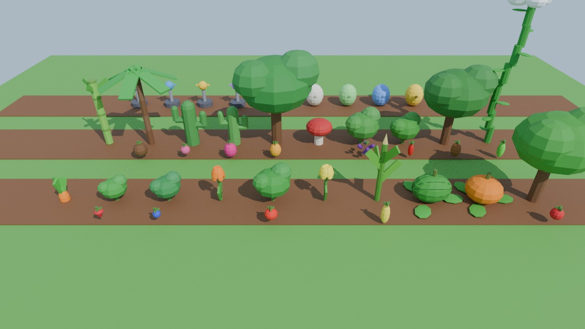

<p>
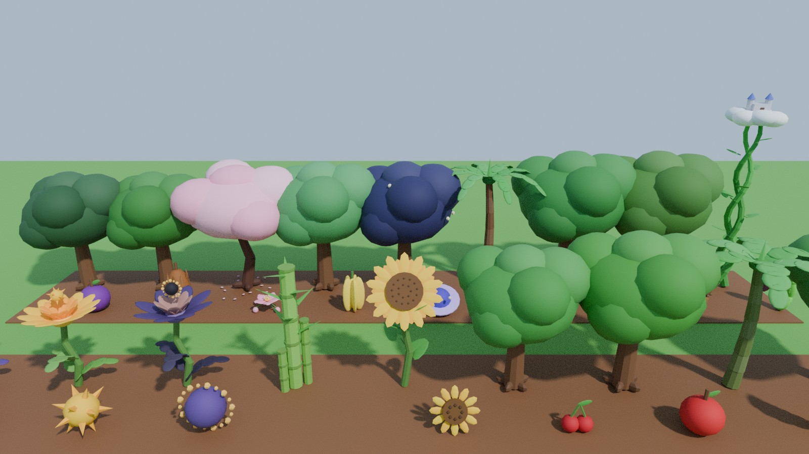 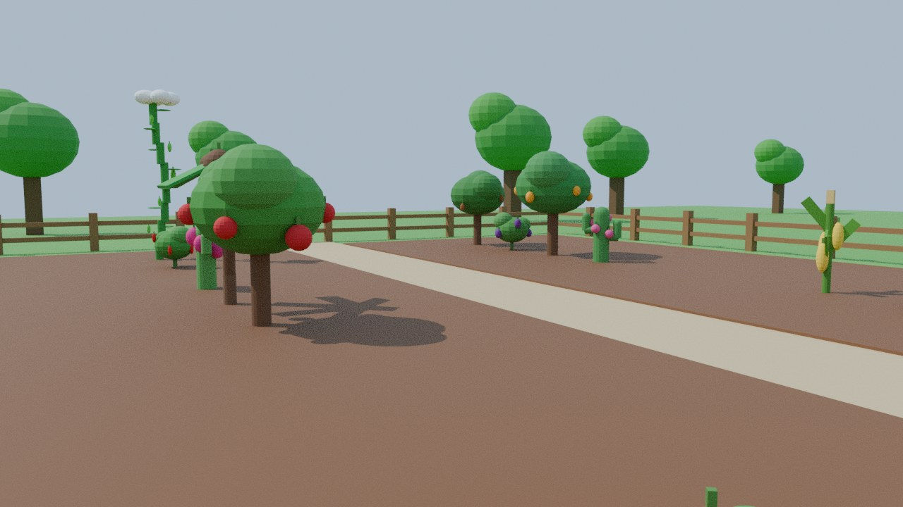
</p>

A pasta `blender/` tem:

- **`gerar_modelos.py`** — script do Blender que cria os **95 modelos** low-poly: as 45 plantas,
  37 frutos (todas as plantas de várias colheitas), 5 sprinklers, 6 ovos, o Gnomo e a Lanterna.
  Pinta tudo com uma textura de paleta e exporta em `.fbx`.
- **`modelos_exportados/fbx/`** — os 95 arquivos `.fbx` **já prontos** (com a textura embutida).
- **`modelos_exportados/CultiveUmJardim_Modelos.blend`** — o arquivo do Blender com a vitrine montada.

### Gerar de novo / editar no Blender (4.2 ou mais novo)

- No Blender: aba **Scripting › Open** → `gerar_modelos.py` → **Run Script**.
  (Ele cria uma cena nova e não apaga o que você tinha aberto.)
- Pelo terminal: `blender --background --python blender/gerar_modelos.py`

As cores, alturas e tamanhos vêm dos mesmos valores do `Config.luau`, e as plantas têm as mesmas
proporções das plantas feitas com Parts, para os frutos nascerem nos lugares certos.

### Colocar os modelos no jogo

O jogo **funciona sem importar nada**: se um modelo não existir, ele monta a planta com Parts.
Para usar os modelos do Blender:

1. No Roblox Studio abra o **Importador 3D** (*File › Import 3D* ou *Home › Import 3D*).
2. Escolha os `.fbx` de `blender/modelos_exportados/fbx/` e importe.
3. Arraste os modelos importados para **ReplicatedStorage › Modelos**, **sem mudar os nomes**
   (ex.: `Planta_CherryBlossom`, `Fruto_Apple`, `Sprinkler_CommonSprinkler`, `Ovo_CommonEgg`, `Gnomo`).
4. Dê Play. O jogo ajusta o tamanho dos modelos sozinho.

Regras de nome (se você fizer seus próprios modelos):

| Nome do modelo | Uso |
|---|---|
| `Planta_<IdDaSemente>` | corpo da planta (ex.: `Planta_Mango`) |
| `Fruto_<IdDaSemente>` | fruto das plantas de várias colheitas |
| `Sprinkler_<IdDoItem>` | sprinkler |
| `Ovo_<IdDoOvo>` | ovo chocando no jardim |
| `Gnomo` · `Lanterna` | gnomo de proteção e lanterna |

| Peça com no nome… | O que o jogo faz |
|---|---|
| **Produto** | é o fruto: fica verde antes de amadurecer e muda de cor com variantes e mutações (a textura volta quando ele está maduro, sem variante e sem mutação) |
| **Brilho** | ganha uma luz da cor do fruto |
| **Copa** | solta pétalas (Cerejeira) |
| **Cabeca** | de onde sai a água do sprinkler |
| **Vidro** | onde fica a luz da lanterna |

Os IDs estão no `Config.luau` (`id = "Carrot"`, `id = "CherryBlossom"`, ...).

---

## 🎮 Como jogar

1. Você começa com **¢20** e **2 sementes de Cenoura**.
2. Fale com o **Sam** (ou clique em **🌱 Sementes**) para comprar sementes.
3. Equipe a semente (tecla **1** ou toque na barra) e **clique na terra marrom** do seu jardim.
4. Veja o broto virar planta. Quando o fruto ficar maduro, aperte **E** para **Colher**.
5. Venda com o **Steven** (**💰 Vender**) e compre equipamentos com o **George** e ovos com a **Eloise**.
6. Faça as **📜 Missões** do dia e confira o **✨ Índice de Mutações**.
7. Passe o mouse em cima das plantas para ver peso, tamanho, variante, mutações e quanto falta.

**De noite:** fique no seu jardim (ele fica trancado) ou deixe um **Gnomo** protegendo. Para roubar,
vá até um jardim sem o dono, segure **Roubar** num fruto maduro e corra até o seu jardim. Se alguém
te acertar com a Pá ou com o Atirador de Morango, você solta o fruto.

**Espátula:** clique numa planta e depois num lugar livre para mudá-la de lugar. Clique em duas plantas
adultas da receita certa para fazer uma **fusão secreta**.

**Pá:** clique duas vezes na mesma planta para removê-la.
**Sprinkler / Ovo / Lanterna / Gnomo:** equipe e clique em qualquer lugar do seu jardim.

### Comandos de teste (só funcionam dentro do Roblox Studio)

| Comando no chat | O que faz |
|---|---|
| `/sheckles 100000` | ganha Sheckles |
| `/crescer` | todas as suas plantas e ovos ficam prontos |
| `/estoque` | enche o estoque das lojas |
| `/noite` · `/dia` | pula para a noite ou para o dia |
| `/clima chuva` · `/clima lua de sangue` · `/clima eclipse` · `/clima parar` | controla o clima |
| `/pet unicornio` · `/pet dragao mega` · `/pet libelula dourada grande` | ganha um pet (a variante é opcional) |

---

## 🛠️ Personalizar

Quase tudo fica em **`src/ReplicatedStorage/Shared/Config.luau`**:

- preços, tempo de crescimento, valor, peso, variante e defesa de cada semente;
- chance de aparecer na loja e quantidade em estoque;
- equipamentos, ovos, pets, habilidades e variantes de pets;
- mutações, combinações e multiplicadores;
- climas, duração do dia e da noite e regras de roubo;
- missões diárias, receitas de fusão, dinheiro inicial e limite de plantas.

Para adicionar uma semente nova, copie um bloco da `SeedList`, mude o `id`/`name`/valores e escolha
um `plantType` (`root`, `bush`, `flower`, `tall`, `ground`, `tree`, `stalk`, `palm`, `cactus`,
`mushroom`, `beanstalk`, `vine`, `fern`, `flytrap`, `bloom`, `sunflower`, `spitter`, `popsicle`,
`pineapple`, `glowshroom` ou `blossom`).

---

## ✅ Testes: como sei que não tem erros

Para testar sem abrir o Roblox Studio, o projeto tem um **simulador do Roblox**
(`ferramentas/teste/`) que roda os scripts no **Luau de verdade** e confere cada acesso usando a
**lista oficial de APIs do Roblox** (classes, propriedades, métodos, eventos e enums, além dos tipos
dos valores).

O cenário de teste joga o jogo inteiro: entra com vários jogadores, compra e planta **todas** as
sementes da loja, acompanha broto, crescimento e amadurecimento, colhe, vende, faz fusões com a
Espátula, usa todos os equipamentos e cogumelos, choca ovos, sobe pets de nível, completa missões,
passa pelos 18 climas, pelo dia e pela noite, rouba e defende jardins (tranca, Gnomo, plantas de defesa,
Pá, Flor Hipnótica), renasce, sai e volta (crescimento offline), converte dados da versão anterior,
simula falha do DataStore, enche o servidor e usa modelos importados do Blender.

```
CHECAGENS: 290, falharam: 0, erros: 0
Metodos sem simulacao: (nenhum)
APIs obsoletas usadas: (nenhuma)
```

Para rodar de novo (precisa de Node.js 18+ e Python 3):

```bash
bash ferramentas/teste/testar.sh
```

> O simulador pega erros de nome de propriedade, enum, tipo de valor, chamada com `.` no lugar de `:`,
> espera infinita, dados que não podem ser salvos etc. Mesmo assim ele não é o Roblox de verdade:
> teste também no Studio antes de publicar.

---

## 🔎 Pesquisa

As plantas, mutações, climas, pets e regras de roubo e defesa foram baseados em guias e wikis públicos
do Grow a Garden 2 e do Grow a Garden original (Fandom, Game8, GameRant, Beebom, Allthings.how,
Nerdschalk, TheGamer e outros). Os valores foram ajustados para este jogo.

---

## 📁 Estrutura

```
GrowAGarden-Roblox/
├── CultiveUmJardim.rbxlx        ← lugar pronto para abrir no Roblox Studio
├── default.project.json         ← projeto Rojo
├── src/                         ← todo o código Luau do jogo
├── blender/
│   ├── gerar_modelos.py         ← gera os modelos 3D no Blender
│   └── modelos_exportados/      ← .fbx prontos + .blend + prévias
├── ferramentas/
│   ├── gerar_rbxlx.py           ← recria o .rbxlx a partir de src/
│   └── teste/                   ← simulador do Roblox + cenário de teste
└── docs/                        ← imagens deste README
```

Se você mudar algo em `src/`, rode `python3 ferramentas/gerar_rbxlx.py` para atualizar o `.rbxlx`.
